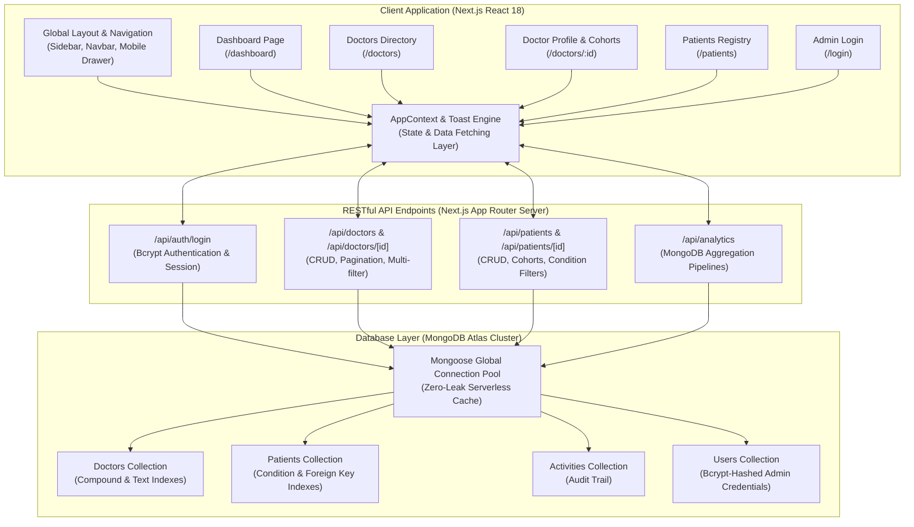

# Doctor Tracker – Enterprise Healthcare Administration

## Description
**Doctor Tracker** is an enterprise-grade healthcare administrative web application engineered for hospital networks to seamlessly monitor, manage, and coordinate medical specialists and their corresponding patient cohorts. Built with a focus on clinical performance, WCAG 2.1 AA accessibility, and real-time medical data visualization, Doctor Tracker unifies doctor directories, clinical condition tracking (from ICU-level critical cases to routine checkups), and workload distribution analytics into a centralized command center powered by a robust Next.js full-stack architecture and a live MongoDB Atlas cloud database.

---

## Setup Guide

Follow these steps to run Doctor Tracker locally on your development machine:

### Prerequisites
- **Node.js**: v18.17.0 or higher (v20+ recommended)
- **npm** (or **pnpm** / **yarn**)
- **MongoDB Atlas** account or local MongoDB instance (URI pre-configured in `.env.local`)

### 1. Clone & Navigate to Project
```bash
git clone https://github.com/your-username/doctor-tracker.git
cd "Doctor tracker"
```

### 2. Environment Configuration
Create a `.env.local` file in the project root (see `.env.example`):
```bash
cp .env.example .env.local
```

Populate `.env.local` with your configuration:
```env
# Database & Authentication (for fullstack Next.js mode)
MONGODB_URI=mongodb+srv://<username>:<password>@cluster0.mongodb.net/doctortracker?retryWrites=true&w=majority
JWT_SECRET=super_secret_jwt_doctor_tracker_key_2026
NEXT_PUBLIC_APP_URL=http://localhost:3000

# Optional: Standalone Backend API URL (for decoupled microservice mode)
# Leave empty to use built-in Next.js route handlers, or set to your standalone Express backend:
# NEXT_PUBLIC_API_URL=http://localhost:5000
```

### 3. Install Dependencies
```bash
npm install
```

### 4. Run the Application
**Development Mode:**
```bash
npm run dev
```

**Production Build & Start:**
```bash
npm run build
npm start
```
Open [http://localhost:3000](http://localhost:3000) in your browser to view the application.

### Demo Admin Credentials
- **Email:** `admin@doctortracker.health`
- **Password:** `AdminSecure2026!`
*(An "Autofill Demo Admin Credentials" shortcut is also available directly on the login screen for one-click access).*

---

## System Architecture



### Data Flow Overview
1. **Authentication Guard:** Protected routes verify administrator authentication via `AppContext`. Unauthenticated requests redirect immediately to the split-screen `/login` portal.
2. **RESTful Architecture:** Frontend interacts with server endpoints over HTTP JSON REST APIs (`/api/doctors`, `/api/patients`, `/api/analytics`, `/api/auth/login`).
3. **MongoDB Aggregation Pipelines:** Dashboard metrics (`totalDoctors`, `totalPatients`, `avgPatientsPerDoctor`, condition distributions, and clinician caseloads) are computed directly on the database engine using MongoDB `$lookup`, `$facet`, and `$group` aggregations for sub-millisecond execution times.
4. **Optimized Indexing:** Compound indexes on `DoctorSchema` (`{ name: 'text', specialization: 1 }`) and `PatientSchema` (`{ doctorId: 1, createdAt: -1 }`, `{ condition: 1, admissionDate: -1 }`) ensure search, sort, and filter operations scale to tens of thousands of records.

---

## Technical Decisions

### Decision 1: MongoDB Aggregation Pipeline ($facet & $lookup) over In-Memory Array Reductions
* **Context:** The administrative dashboard requires multiple simultaneous analytics: KPI counters, patients per doctor bar charts, condition distribution percentages, and 30-day influx curves.
* **Alternative Considered:** Fetching raw arrays of doctors and patients to the Node.js server and aggregating them with Javascript `.reduce()` or `.filter()`.
* **Why We Chose MongoDB Aggregation Pipelines:**
  1. *Sub-Millisecond Query Performance:* Aggregation pipelines execute directly inside MongoDB's C++ WiredTiger query engine, avoiding massive memory allocations in Node.js when patient registries scale.
  2. *Single Network Roundtrip via `$facet`:* We execute multi-dimensional analytical queries in a single `$facet` pipeline, fetching KPI metrics, cohort distributions, and clinician rankings simultaneously.
  3. *Zero Over-Fetching:* Only computed totals and chart aggregates are transmitted over the network rather than thousands of patient documents.

### Decision 2: Global Mongoose Connection Caching in Serverless Next.js
* **Context:** In Next.js App Router server environments, API route invocations can create redundant database connections if not properly managed, rapidly exhausting MongoDB Atlas connection limits.
* **Alternative Considered:** Establishing a fresh `mongoose.connect()` on every API request or relying on an external persistent ORM daemon.
* **Why We Chose Global Cached Connection Pool (`src/lib/db.ts`):**
  1. *Connection Reuse:* By caching the connection promise on Node's `global` object, all incoming API requests reuse existing pooled TCP sockets.
  2. *Automatic Reconnection & Stability:* Prevents the dreaded `MongoNotConnectedError` and connection pool timeouts during high concurrency bursts.
  3. *Standardized Across Local & Cloud:* Works seamlessly both locally on dev servers and when deployed to Vercel/AWS serverless edge environments.

---

## Visual Evidence & Features Showcase

### 1. Split-Screen Administrator Login (`/login`)
- **Visual Design:** High-contrast split-screen featuring an enterprise command summary on the right and authentication form on the left.
- **Features:** Password visibility toggle, remember-me session persistence, validation error handling, and one-click demo credential autofill (`admin@doctortracker.health`).

### 2. Clinical Command Dashboard (`/dashboard`)
- **Welcome Banner:** Personalized time-based greeting, live calendar date, and rapid action buttons.
- **KPI Metrics:** Total Doctors, Total Patients, Average Patients/Doctor ratio, and Critical/Serious cohort counter.
- **Visual Analytics:**
  - *Patients per Doctor:* Interactive vertical bar chart highlighting clinician volume.
  - *Status Breakdown:* Donut chart displaying proportions of Critical, Serious, Stable, Recovering, and Routine checkups.
  - *Date Influx Trends:* Area chart with selectable time windows (**Past 7 Days**, **Past 30 Days**, **Past 90 Days**).
- **Recent Administrative Activity:** Real-time chronological audit trail of all doctor and patient events directly from MongoDB.

### 3. Doctor Management Directory (`/doctors`)
- **Search & Filters:** Real-time debounced multi-field search, medical specialization dropdown, hospital affiliation filter, and registration date-range filters.
- **Data Presentation:** Doctor avatar with initials, specialty badges, hospital affiliation, contact details, active cohort pill, and action buttons.
- **Modals:** Slide-in modals for **Register New Doctor**, **Edit Doctor Information**, and **Confirm Deletion**.
- **Sorting & Pagination:** Instant column sorting by doctor name, patient volume, or registration date.

### 4. Doctor Profile & Dedicated Cohort View (`/doctors/[id]`)
- **Profile Header:** Specialty badges, hospital affiliation, contact info, and cohort summary cards.
- **Patient Cohort Table:** View all patients specifically assigned to this physician, with instant condition tags and direct patient enrollment.

### 5. Patient Management Registry (`/patients`)
- **Condition Summary Pills:** Quick-filter buttons for Critical, Serious, Stable, Recovering, and Routine checkup cohorts.
- **Multi-Filter Toolbar:** Filter by clinical condition, assigned specialist, or admission date.
- **Modals:** **Add New Patient**, **Update Patient Record**, and **Remove Patient Record**.

### 6. Global Spotlight Search (`⌘K` / `Ctrl+K`)
- Accessible from any screen via the navigation bar search input or keyboard shortcut, allowing instant jump to any doctor or patient.

---

## License
MIT License. Created for the **Doctor Tracker** healthcare administration evaluation.
